# Nestly

**Find, book and pay for a verified hostel room from your phone.**

Nestly is a web platform for university students in Uganda. Students search and compare hostels near their campus, book a room and pay a booking fee by mobile money. Hostel owners and custodians manage bookings, rooms, rent balances and visitors in one place, and an administrator checks every owner before their hostel is listed.

Built by Group 1 for **MGT3151 E-Business, E-Commerce and E-Governance** at Uganda Christian University (Advent 2026), project option B: E-Commerce.

| | |
|---|---|
| **Live prototype** | https://nestly-ug.vercel.app |
| **Demo password** | `nestly123` (accounts below) |
| **Payments** | Flutterwave sandbox only. No real money moves. |
| **Data** | All names, hostels and payments are fictitious. |

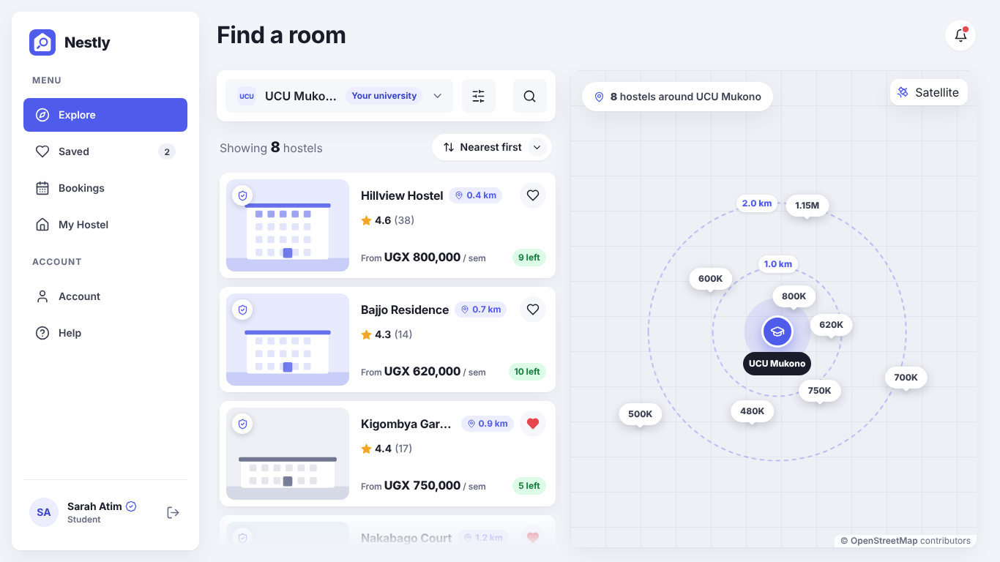

---

## Contents

1. [What it does](#what-it-does)
2. [Screenshots](#screenshots)
3. [Run it on your computer](#run-it-on-your-computer)
4. [Demo accounts](#demo-accounts)
5. [Tests](#tests)
6. [How it is built](#how-it-is-built)
7. [Project structure](#project-structure)
8. [Team](#team)

---

## What it does

Nestly covers the full e-commerce workflow, from finding a room to reviewing the stay.

| Step | What happens in Nestly |
|---|---|
| **1. Discover** | Search hostels near a campus, filter by price and room type, and see them on a map. No account needed. |
| **2. Select** | Open a hostel page with photos, room types, prices, rooms left, reviews and the walking distance to campus. |
| **3. Order** | Book one room type for the semester (one booking per student per semester). |
| **4. Pay** | Pay the booking fee by MTN or Airtel mobile money. The booking is confirmed only after the server checks the payment with Flutterwave. |
| **5. Fulfil** | The owner sees the fee. The custodian gives the student a room, records the rent balance and checks them in. |
| **6. After-sales** | Free cancellation within 48 hours, a receipt for every booking, and one verified review per stay. |

### Who uses it

| Role | What they can do |
|---|---|
| **Student** | Search, save, book and pay; see bookings, receipts and their hostel |
| **Hostel owner** | List hostels, track bookings and fees, invite custodians, pay the monthly subscription |
| **Custodian** | See arrivals, give rooms, record rent balances, check students in, manage visitors |
| **Visitor** | Sign in at the hostel gate by scanning a QR code, without an account |
| **Administrator** | Verify owners and listings, handle reports, manage users and subscriptions |

---

## Screenshots

### Students

| Hostel page | Paying the booking fee |
|---|---|
| 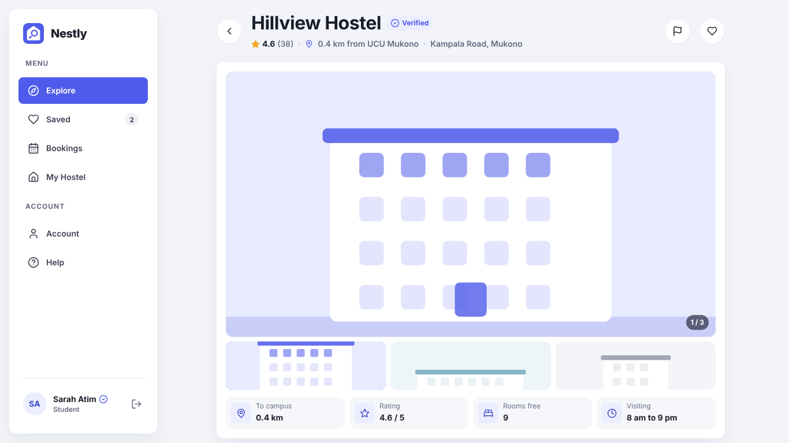 | 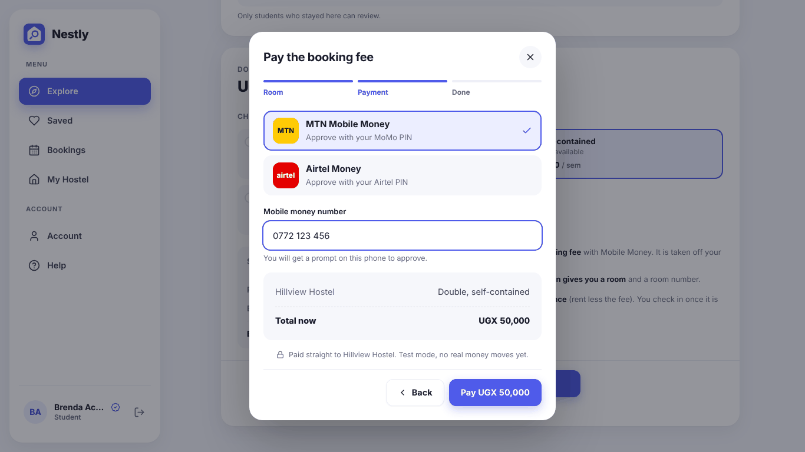 |
| **Booking confirmed with a reference** | **My bookings** |
| 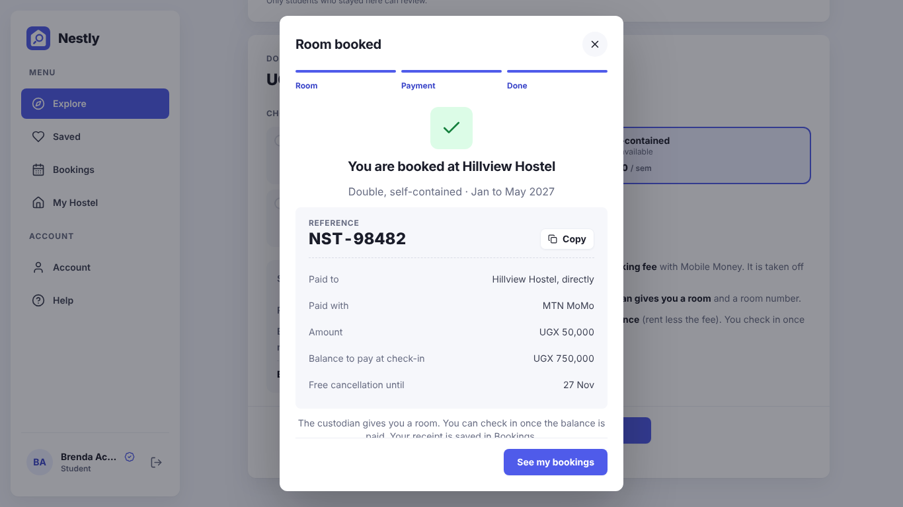 | 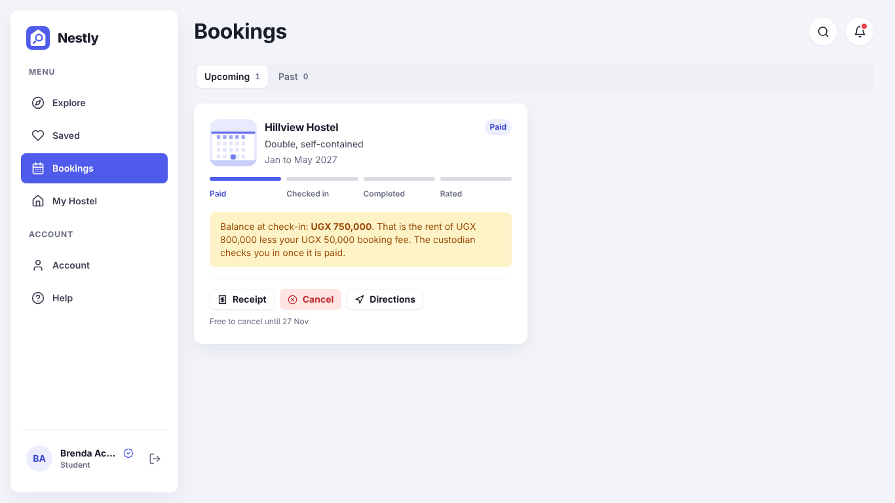 |

### Owners, custodians and administrators

| Owner overview | Owner money page |
|---|---|
| 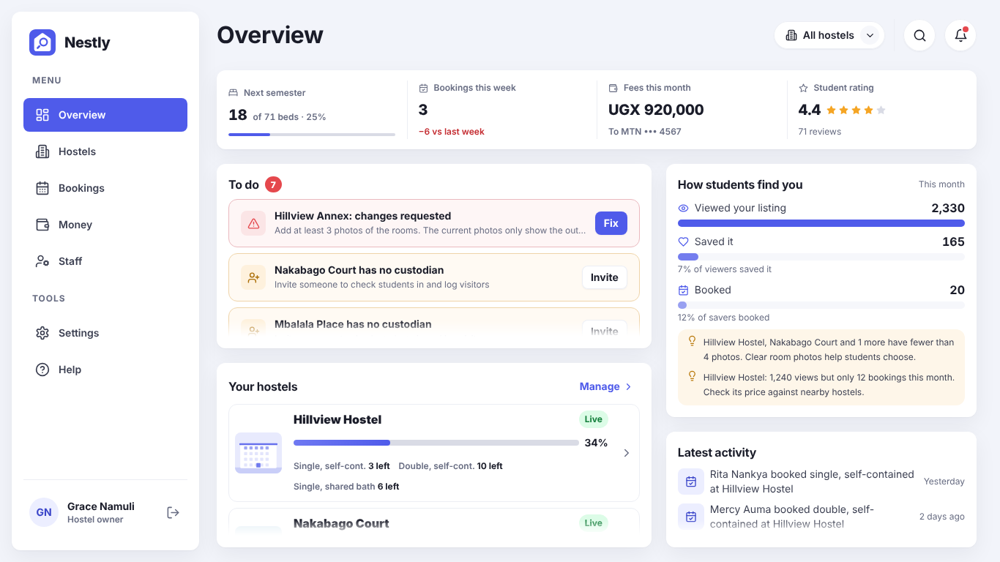 | 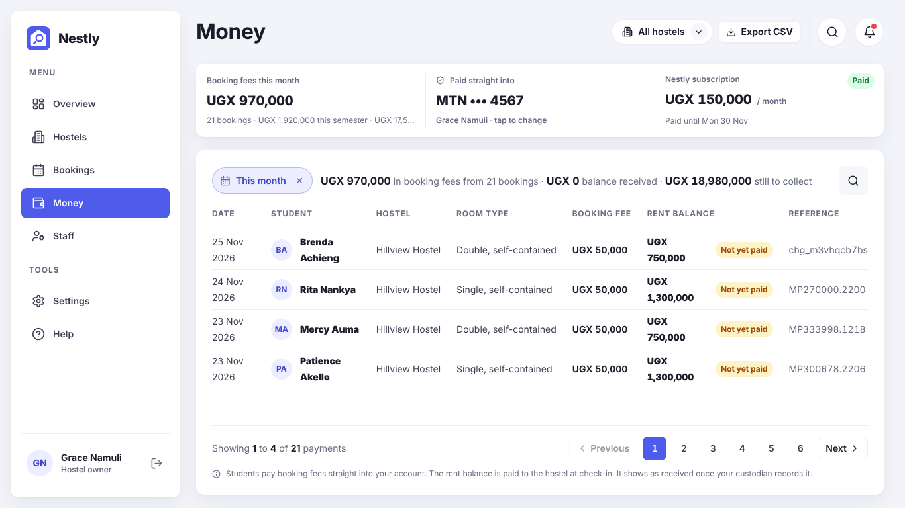 |
| **Custodian: today's arrivals** | **Administrator: work queue and activity** |
| 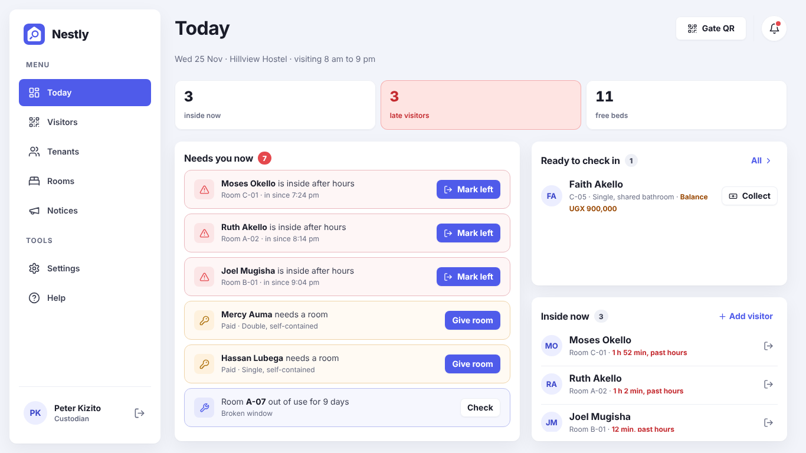 | 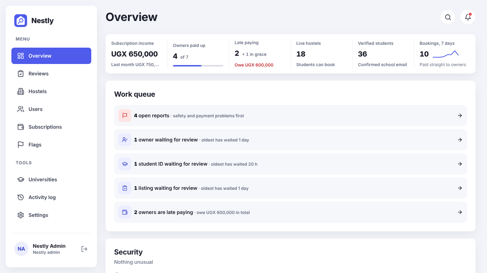 |

### On a phone

Every screen is designed for a 360-pixel phone first. From left: Explore, a hostel page, visitor sign-in at the gate, and the custodian's Today page.

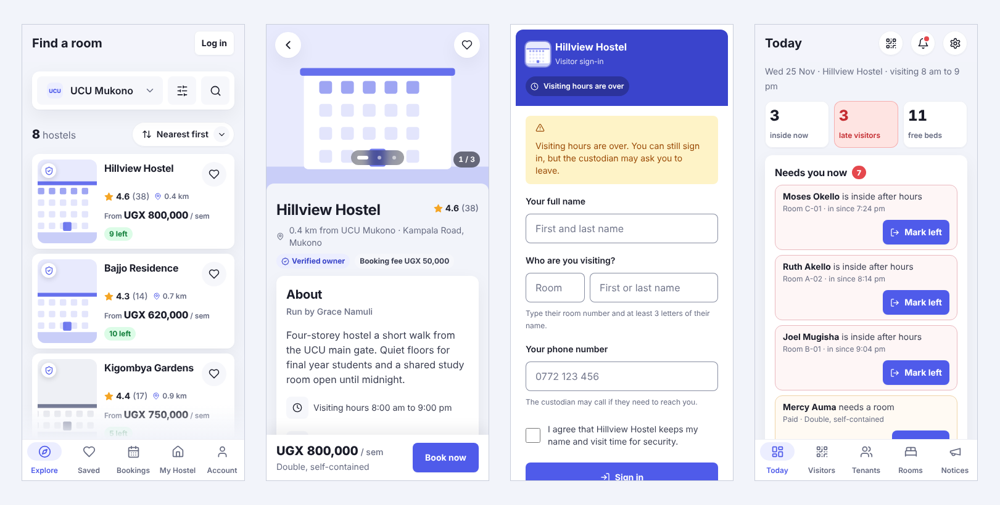

---

## Run it on your computer

You need **Node.js 18 or newer** (we use Node.js 22). Exact library versions are fixed in `package-lock.json`.

### Option 1: Quick demo (about 5 minutes)

This runs every screen with sample data kept in your browser. After installing, it works offline.

```bash
git clone https://github.com/mightymade/nestly.git
cd nestly
npm ci
npm run dev
```

Open **http://localhost:5173** and log in with one of the [demo accounts](#demo-accounts).

> With no `.env` file, Nestly runs in demo mode automatically.

### Option 2: Full set-up with a real database (about 30 minutes)

This is the set-up used by the live prototype and our tests.

1. Create a free project at [supabase.com](https://supabase.com).
2. Follow [`supabase/SETUP.md`](supabase/SETUP.md) step by step:
   - run the files in `supabase/migrations` in order (`0001` to `0009`), then `supabase/sample_data.sql`
   - deploy the two server functions, `payments` and `accept-invite`
   - add your Flutterwave **sandbox** keys as function secrets
3. Copy `.env.example` to `.env` and fill in your project's URL and **anon** (public) key.
4. Run `npm ci`, then `npm run dev`.

> **Never** put the Supabase service key, the database password or the Flutterwave secret in `.env` or in Git. They belong only in the Supabase dashboard.

### Other commands

| Command | What it does |
|---|---|
| `npm run build` | Checks the code for errors, then builds the site into `dist/` |
| `npm run preview` | Serves the built site |
| `npm run build:single` | Builds the whole app as one HTML file in `dist-single/`, for sharing an offline preview |

---

## Demo accounts

All accounts are fictitious. The password for every account is **`nestly123`**.

| Role | Log in with | Try this |
|---|---|---|
| Student | `sarah.atim@ucu.ac.ug` | Find a room, book it, pay in the sandbox, cancel, review |
| Custodian | `peter.k` | Give a room, record the balance, check in, open the gate QR |
| Owner | `grace.n` | Check bookings and fees, invite staff, pay the subscription |
| Owner awaiting approval | `daniel.o` | See what a new owner sees before approval |
| Administrator | `admin` | Approve owners and listings, read the activity log |

In demo mode you can also use the custodian invite code `HILL-4821`, and pay with a phone number ending in `0000` to see a declined payment. The demo box on the login page has **Reset demo** to start fresh.

---

## Tests

The prototype was tested in a real browser (Playwright) against the database, with a screenshot for every step.

| Check | Result (18 Nov 2026) |
|---|---|
| 10 test cases: 7 positive, 2 validation, 1 access control | **10 of 10 pass** |
| 48 screens on phone and laptop, WCAG 2.1 A and AA, keyboard, slow 4G | **0 accessibility violations, 0 layout faults** |

The test scripts and evidence are in the group repository, [Nestly-v0](https://github.com/mightymade/Nestly-v0).

---

## How it is built

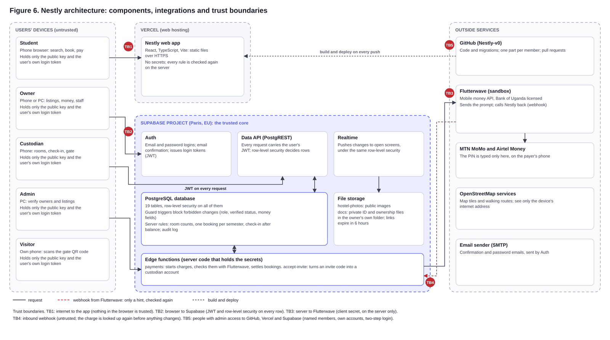

| Part | Technology | Job |
|---|---|---|
| Web app | React 18, TypeScript, Vite | All screens; hosted on Vercel |
| Database | PostgreSQL on Supabase | 19 tables; row-level security decides what each user can see |
| Logins | Supabase Auth | Sign-up, login and email confirmation |
| Files | Supabase Storage | Public hostel photos; private owner documents |
| Payments | Supabase Edge Function + Flutterwave sandbox | Starts each charge and verifies it before a booking is confirmed |
| Maps | Leaflet + OpenStreetMap | Hostel locations and walking routes |

**Security in short:** the browser is never trusted. Every rule (who can see what, one booking per semester, check-in only after the balance is paid) is enforced in the database. Payment secrets live only on the server, and the mobile money PIN is typed only on the payer's phone.

---

## Project structure

```
nestly/
├── src/
│   ├── pages/            Screens for each role: student, owner, custodian, admin, auth
│   ├── components/       Shared building blocks (buttons, cards, tables, maps)
│   ├── styles/           Design system: colours, type and layout
│   ├── services/         Talking to Supabase, and the demo-mode data
│   └── data/             Data types and sample catalogue
├── supabase/
│   ├── migrations/       Database tables, security rules and functions (run in order)
│   ├── functions/        Server code: payments and accept-invite
│   ├── sample_data.sql   Fictitious sample data
│   └── SETUP.md          Step-by-step database set-up
├── docs/screenshots/     Images used in this README
├── .github/              Pull request template
└── package.json          Scripts and library versions
```

---

## Team

| # | Member | Part of the prototype |
|---|---|---|
| 1 | Naguma Elly | Design system and styles |
| 2 | Sellah Kenkyerengye | App shell and data model |
| 3 | Ivan Tweyongyere | Authentication and accounts |
| 4 | Amanya Kevin | Student discovery: Explore, hostel page, saved |
| 5 | Nantongo Jane | Custodian screens and visitor gate |
| 6 | Jotham Praise Onyango | Booking, mobile money payments and rent balance |
| 7 | Muyobo Arnold | Owner dashboard, money, staff and subscription |
| 8 | Wako Wallace | Hostel editor and file storage |
| 9 | Made Humphrey | Admin console; project set-up and integration (team lead) |
| 10 | Katawera Noel Ephraim | Backend core: business rules and database security |

Each member's work, with their pull requests, is in the group repository, [Nestly-v0](https://github.com/mightymade/Nestly-v0).

---

<sub>A student project for MGT3151 at Uganda Christian University. All data is fictitious and all payments use the Flutterwave sandbox. Generative AI use is declared in the project report. Map data © OpenStreetMap contributors.</sub>
